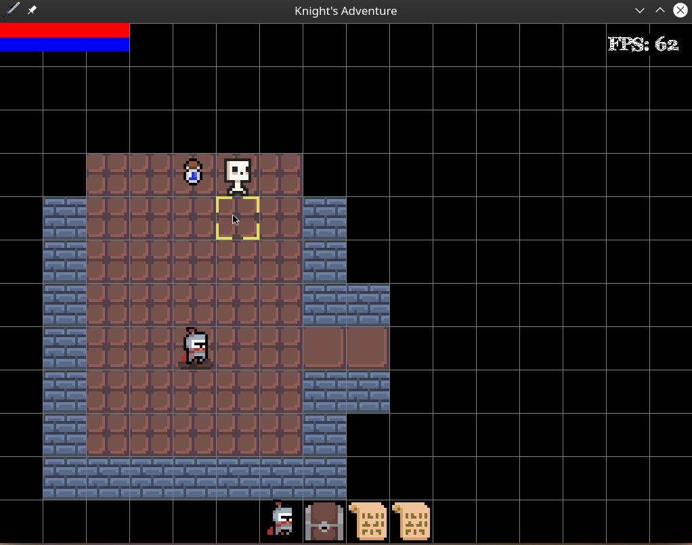

# Infinite Dungeon — CS3101 Edition

> **CS3101: Design and Analysis of Algorithms Course Project**  
> An infinite, procedurally generated, top-down grid-based dungeon crawler built in Python & Pygame, featuring self-implemented graph algorithms, heuristic search, dynamic programming, and constraint-satisfaction backtracking — each one wired into actual gameplay, not just a menu.



---

## 1. Project Overview

**Infinite Dungeon** transforms an existing Pygame roguelike base into an infinite algorithmic dungeon crawler. All algorithms are written from first principles in readable, modular Python, are part of real-time gameplay, and are evaluated with empirical benchmarks:

1. **Procedural Dungeon Generation**
   - **Recursive Backtracking**: randomised DFS maze carver with chambers and loop passages.
   - **Random Rooms + Minimum Spanning Tree**: non-overlapping rooms connected by **Kruskal's algorithm** with **Disjoint Set Union** (path compression + union by rank), plus extra loop edges.
   - **Double-sweep BFS** puts the spawn and the exit at the two ends of the dungeon (tree-diameter trick), so every floor has to be crossed.
   - **Mud pools** (terrain cost 3) are grown by random walks, and pillars block movement but not sight.
   - **Generation replay** (`B`): every generator records its steps and the game plays them back — rooms accepted/rejected, each Kruskal edge with the Union-Find decision, the DFS stack, the BFS waves.
   - **Seeded**: each new run rolls a seed (shown in the F1 HUD); `FIXED_SEED` in `src/config.py` replays a dungeon exactly.
2. **Graph Traversal & Validation**: BFS / DFS connectivity checks, connected components, automatic corridor repair, dead-end detection (used to hide bonus loot).
3. **Enemy Pathfinding — every enemy type uses a different algorithm**

   | Enemy | Algorithm | What you see in game |
   | :--- | :--- | :--- |
   | Slime | **BFS** | Ignores terrain cost — wades straight into mud and gets stuck |
   | Goblin | **Greedy Best-First** | Follows its nose: tiny search, but often a worse route |
   | Skeleton | **A\*** (Chebyshev heuristic) | Optimal path with a small, focused search |
   | Flying beast | **Dijkstra** | Optimal; flies over mud so every tile costs the same |

   `O` forces one algorithm on every enemy for side-by-side comparison. With `F1` each enemy's planned path is drawn in its algorithm's colour, with live average nodes / time / cost per algorithm.
4. **Terrain costs are real turns**: entering mud costs 3 turns (the same weight the searches use) for the player and for enemies, so Dijkstra / A* routes really are faster. Click-to-move uses Dijkstra and walks around mud.
5. **0/1 Knapsack on your real inventory**
   - Every item has a weight and gold value; carry capacity = 18 + 2 × STR. Over capacity, every step costs an extra turn.
   - One **treasure vault** per floor holds ~1.7× more relic weight than you can carry.
   - `K` opens the **loot planner**: DP vs Greedy on your bag + nearby loot, the DP table `dp[i][w]` drawn as a heat map with the reconstruction path, and one key to apply either plan. Relics are banked as gold when you descend.
6. **Constraint-Satisfaction Backtracking**: Ancient Runic Vault puzzle solved by recursive backtracking with forward pruning (`U`).
7. **Locked doors & keys** — every floor has 1–3 locks. Doors go on **cut vertices** found by **Tarjan's articulation-point DFS**, or seal a room with a **vertex cut**; keys are placed so the lock dependencies form a DAG, and **Kahn's topological sort** proves an unlock order exists (shown live in F1). On room floors the exit is locked 86 % of the time.
8. **Negative edge weights** — **healing shrines** (heal + 2 free turns, edge weight −1) and one-way **time rifts** (rewind R turns, weight 1 − R). Right-click plans the fewest-turns route with **Bellman–Ford** and shows where textbook Dijkstra would be wrong; at generation Bellman–Ford finds rifts that form a **negative cycle** (infinite free turns) and seals them.
9. **Danger map** (`N`) — one **multi-source Dijkstra** (walkers, mud = 3) plus **multi-source BFS** (flyers) gives the turns until the nearest enemy can reach every tile, 15.7× faster than one search per enemy with 16 enemies. Shift + click walks the **safest route** (Dijkstra with a danger penalty).
10. **Algorithm Observation Mode** (`F1`): generation stats, seed, spawn→exit distance, per-algorithm pathfinding stats, explored-node overlay and per-enemy paths, the lock graph, key → door links and rift edge weights.
11. **Infinite floor progression** with depth-scaled enemies, more locks and richer vaults.

---

## 2. In-Game Controls

| Key | Action |
|:---:|:---|
| **w / a / s / d** | Walk up / left / down / right (hold to keep walking; hold two for diagonals) |
| **q / e / z / c** | Walk diagonally |
| **x** | Wait a turn |
| **Left click** | Walk to the clicked tile (Dijkstra route, avoids mud) |
| **Right click** | **Fewest-turns route using shrines and rifts** (Bellman–Ford; compares with Dijkstra) |
| **Shift + left click** | **Safest route** (Dijkstra with a danger penalty) |
| *walk into a door* | Open it if you hold its key (keys are picked up by walking over them) |
| **n** | **Danger map**: turns until the nearest enemy can reach each tile (multi-source Dijkstra) |
| *walk onto an item* | Pick it up automatically (skipped if it would make you over-encumbered) |
| **t** | Pick up items here, even if too heavy |
| **h / j / r** | Quick use: health potion / mana potion / teleport scroll |
| **i** | Inventory & equipment (left click use/equip, right click drop) |
| **SPACE** | Cast magic (Fireball, Lightning, Confusion) |
| **k** | **0/1 Knapsack loot planner** (ENTER = take DP plan, G = take greedy plan, C = keep potions on/off) |
| **b** | **Replay how this floor was generated** (SPACE pause, → next phase, ↑/↓ speed, R restart) |
| **o** | **Cycle enemy pathfinding**: Per-type → A\* → Dijkstra → BFS → Greedy |
| **g** | **Cycle next floor's generator**: MST (Kruskal) → Recursive Backtracking → BSP |
| **u** | **Ancient Runic Vault** (backtracking puzzle) |
| **F1** | **Algorithm observation HUD & overlays** |
| **m** | Toggle minimap (shows the vault, and MST edges while F1 is on) |
| **v** | Auto-explore to the nearest unseen tile |
| **TAB** | Free camera (ENTER walks there) |
| **1** (on upstairs) / **2** (on downstairs) | Previous floor / next floor (relics are banked as gold) |
| **p** | Pause |
| **F2 / F3** | Save / load |
| **ESC** | Close the active menu |

---

## 3. Quick Start & Execution

### 3.1 Prerequisites
- Python 3.9+ (tested on Python 3.12.8 and 3.14.7)
- Pygame-CE:
  ```bash
  pip install pygame-ce
  ```

### 3.2 Running the Game
```bash
python src/main.py
```

### 3.3 Running the Unit Tests
33 tests: BFS/DFS reachability, Dijkstra & A\* optimality, heuristic admissibility, Greedy Best-First validity and sub-optimality, dungeon connectivity, seed reproducibility, double-sweep exit placement, Kruskal trace (|V| − 1 edges, sorted order), trace-does-not-change-output, knapsack DP / greedy / reconstruction, backtracking puzzle, Tarjan cut regions vs brute-force BFS, lock plans vs a flood-fill simulation, Kahn cycle detection, Bellman–Ford vs Floyd–Warshall, Dijkstra failing on a negative edge, negative-cycle detection and rift sealing, multi-source vs k single-source searches, safe-route guarantee.
```bash
python -m unittest tests/test_algorithms.py
```

### 3.4 Running the Benchmark Suite
Headless, writes every record to `benchmark_results.csv`:
1. BFS vs Dijkstra vs A\* vs Greedy, spawn → exit on 20×20 / 35×35 / 50×50 floors
2. Enemy chase queries (600 in-game style searches, 4–12 steps)
3. Recursive Backtracking vs Rooms + MST generation
4. Knapsack DP vs Greedy on random instances and on 1,000 realistic treasure vaults
5. Locked doors: Tarjan + vertex cuts + Kahn on 100 floors
6. Bellman–Ford vs textbook Dijkstra with shrines and rifts, negative-cycle sealing
7. Danger map: one multi-source search vs k single-source searches
```bash
python benchmark_runner.py
python benchmark_runner.py --only locks,negative,danger   # just sections 5-7, updates only their CSV rows
```

---

## 4. Documentation Index

- **[`presentation/`](presentation/README.md)**: presentation material — talk outline, one file per algorithm area, live demo script, results, and likely viva questions.
- **[`ALGORITHMS.md`](ALGORITHMS.md)**: specifications, pseudo-code, proofs and complexity of every algorithm, and where each one lives in the game.
- **[`BENCHMARKS.md`](BENCHMARKS.md)**: methodology, results tables and interpretation.
- **[`PROJECT_AUDIT.md`](PROJECT_AUDIT.md)**: the original codebase audit and refactoring strategy.
- **[`ATTRIBUTION.md`](ATTRIBUTION.md)**: base repository credit and asset licenses.
