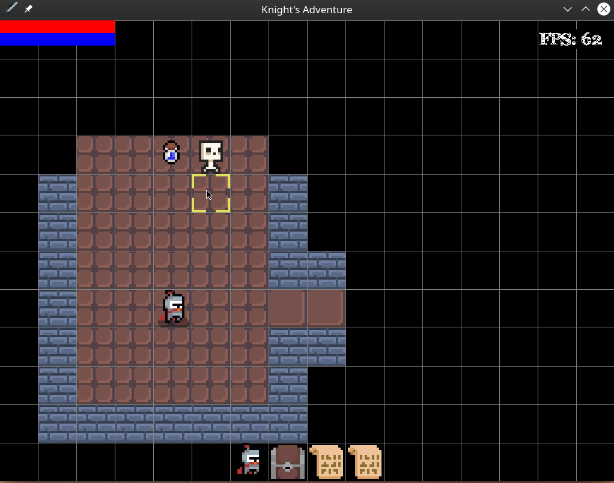

# Infinite Dungeon — CS3101 Edition

> **CS3101: Design and Analysis of Algorithms Course Project**  
> An infinite, procedurally generated, top-down grid-based dungeon crawler built in Python & Pygame, featuring self-implemented graph algorithms, heuristic search, dynamic programming, and constraint-satisfaction backtracking.



---

## 1. Project Overview

**Infinite Dungeon** transforms an existing Pygame roguelike base into an infinite algorithmic dungeon crawler. Designed specifically for **CS3101 (Design and Analysis of Algorithms)**, all algorithms have been authored from first principles in readable, modular Python, integrated into actual real-time gameplay, and evaluated with empirical benchmarks:

1. **Procedural Dungeon Generation**:
   - **Recursive Backtracking**: Randomized DFS grid carver creating dense labyrinths with alcoves and loop passages.
   - **Randomized Room Placement + Minimum Spanning Tree (MST)**: Non-overlapping rectangular room placement connected via **Kruskal's Algorithm** with **Disjoint Set Union (DSU)** and cycle loop additions.
   - **Seed Reproducibility**: Seed-deterministic generation across all floors ($Floor_n = \text{hash}(Seed, n)$).
2. **Graph Traversal & Validation**:
   - **BFS & DFS**: Evaluates graph connectivity and step distances.
   - **Automated Validation**: Verifies spawn point walkability, exit reachable via BFS, and checks connected components.
   - **Topological Repair**: Automatically carves Manhattan corridors between disconnected rooms.
3. **Enemy Pathfinding**:
   - **BFS**: Unweighted uniform-cost shortest path.
   - **Dijkstra's Algorithm**: Min-heap shortest path accounting for variable terrain costs (Standard floor $w=1.0$, Mud hazard $w=3.0$).
   - **A\* Search**: Priority queue with admissible Octile/Chebyshev distance heuristics.
   - **Live In-Game Switching**: Switch enemy AI pathfinding between A*, Dijkstra, and BFS at runtime (`O` key).
4. **Dynamic Programming Optimization**:
   - **0/1 Knapsack Problem**: Optimizes equipment and vault relic selection under player carry-weight capacity.
   - **Greedy Baseline Comparison**: Compares the 2D DP optimal subset against the Greedy efficiency ratio ($v_i / w_i$) heuristic (`K` key).
5. **Constraint-Satisfaction Backtracking**:
   - **Ancient Runic Vault Puzzle**: Multi-dial rune puzzle with adjacent inequality and target sum constraints, featuring a recursive backtracking solver with forward pruning (`U` key).
6. **Algorithm Observation & Dev Mode**:
   - Real-time on-screen HUD and transparent map overlays displaying explored node sets, path traces, visited counts, and execution runtimes (`F1` key).
7. **Infinite Floor Progression**:
   - Endless descent past Floor 6 with depth-scaled enemy HP, attack strength, and elite monster variety including flying beasts (`2` key on downstairs).

---

## 2. In-Game Controls

| Key | Action |
|:---:|:---:|
| **w / a / s / d** | Walk Up / Left / Down / Right |
| **q / e / z / c** | Walk Diagonally (Up-Left, Up-Right, Down-Left, Down-Right) |
| **x** | Wait a turn (Stay still) |
| **Left Click** | Move player directly to clicked tile |
| **m** | Toggle Minimap |
| **t** | Pick up item / equipment |
| **i** | Open Inventory & Equipment Screen |
| **p** | Pause game |
| **SPACE** | Cast Magic spells (Fireball, Lightning, Confusion) |
| **TAB** | Toggle Free Camera mode |
| **1 (on upstairs)** | Ascend to previous floor |
| **2 (on downstairs)** | **Descend to next floor (Infinite Dungeon progression)** |
| **F1** | **Toggle Algorithm Observation HUD & Explored Grid Overlay** |
| **o** | **Cycle Enemy Pathfinding Algorithm (`A*` $\leftrightarrow$ `Dijkstra` $\leftrightarrow$ `BFS`)** |
| **g** | **Cycle Next Floor Generator (`MST (Kruskal)` $\leftrightarrow$ `Recursive Backtracking` $\leftrightarrow$ `BSP`)** |
| **k** | **Open 0/1 Knapsack Inventory Optimizer (DP vs Greedy comparison)** |
| **u** | **Open Ancient Runic Vault (Backtracking constraint puzzle)** |
| **F2 / F3** | Save game / Load game |
| **ESC** | Close active menu |

---

## 3. Quick Start & Execution

### 3.1 Prerequisites
- Python 3.9+ (Tested on Python 3.14.7)
- Pygame or Pygame-CE:
  ```bash
  pip install pygame-ce
  ```

### 3.2 Running the Game
To launch the interactive game:
```bash
python src/main.py
```

### 3.3 Running Automated Unit Tests
To execute the automated verification test suite (14 unit tests covering BFS/DFS reachability, Dijkstra & A* path cost optimality, heuristic admissibility, dungeon connectivity, and knapsack DP):
```bash
python -m unittest tests/test_algorithms.py
```

### 3.4 Running the Empirical Benchmark Suite
To run the automated, headless benchmarking suite across all algorithms, grid sizes ($20\times 20$, $35\times 35$, $50\times 50$), and seeds:
```bash
python benchmark_runner.py
```
This runs all experiments headlessly and exports the empirical records to [`benchmark_results.csv`](file:///benchmark_results.csv).

---

## 4. Documentation Index

- **[`PROJECT_AUDIT.md`](file:///PROJECT_AUDIT.md)**: Initial codebase audit, identified systems, architectural analysis, and refactoring strategy.
- **[`ALGORITHMS.md`](file:///ALGORITHMS.md)**: Detailed technical specifications, pseudo-code, mathematical formulations, admissibility proofs, and asymptotic complexity analysis ($O(V+E)$, $O((V+E)\log V)$, $O(N \cdot W)$).
- **[`BENCHMARKS.md`](file:///BENCHMARKS.md)**: Experimental methodology, benchmark results tables, memory profiles, and algorithmic interpretation.
- **[`ATTRIBUTION.md`](file:///ATTRIBUTION.md)**: Original base repository credit, pixel art sprite licenses, and source credits.
