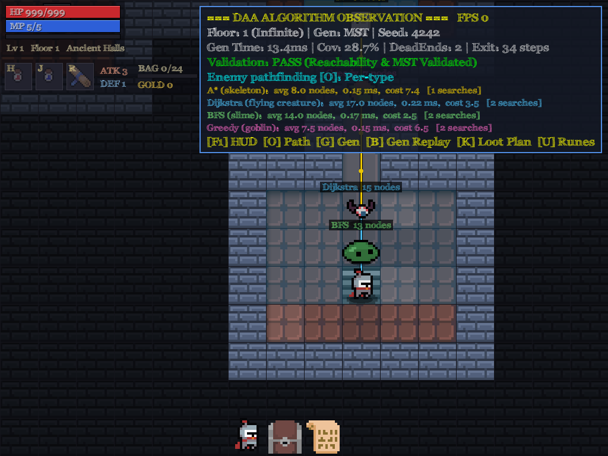
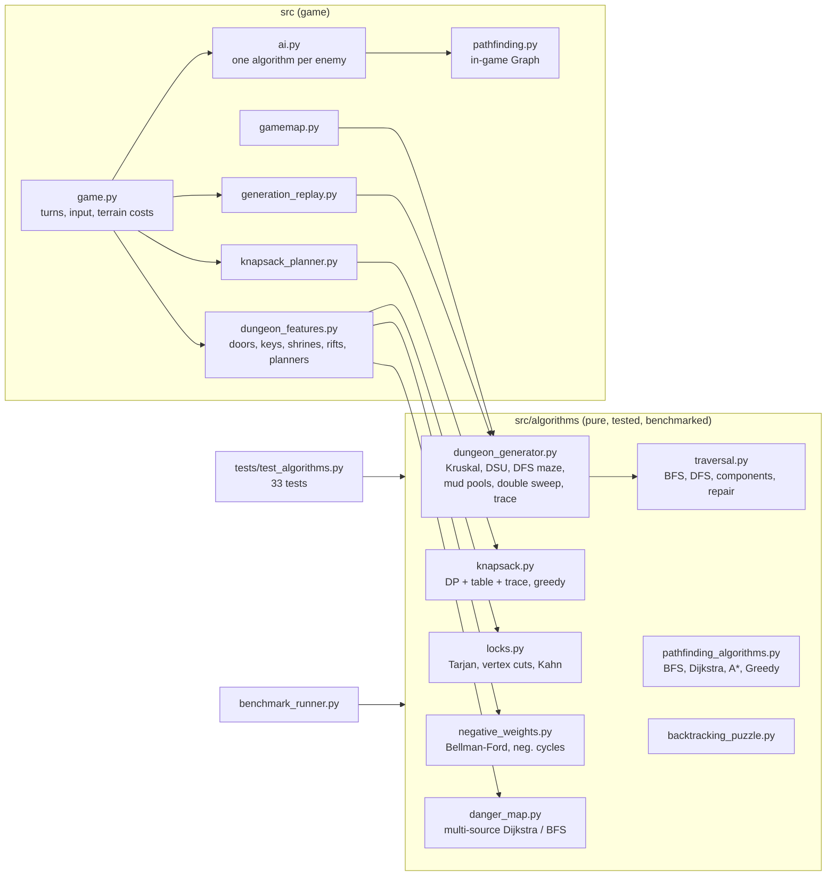

# 1. Overview

## Slide: What We Built

- A turn-based dungeon crawler with **infinite, procedurally generated floors**.
- Every major system is a classic algorithm **that the player can feel**, not a separate demo menu:
  - the map is built by **Kruskal's MST** or a **randomised DFS maze**;
  - each enemy type hunts with a **different search algorithm** (BFS, Greedy Best-First, A\*, Dijkstra);
  - mud has **edge weight 3** and really costs 3 turns;
  - your bag is a **0/1 knapsack**, and every floor has a treasure vault with more loot than you can carry;
  - a **backtracking** solver guarantees the rune puzzle is solvable;
  - locked doors sit on **cut vertices / vertex cuts** (Tarjan) and **Kahn's topological sort** proves an unlock order exists;
  - healing shrines and time rifts are **negative edges**: right-click routes use **Bellman–Ford**, which also seals rifts that would form a **negative cycle**;
  - `N` shows a **multi-source Dijkstra** danger map, and Shift + click walks the safest route.
- An observation mode (`F1`) and a step-by-step **generation replay** (`B`) let you watch the algorithms run.

## Slide: The Algorithm Map

| Gameplay moment | Algorithm | Complexity |
| :--- | :--- | :--- |
| New floor: connect rooms | Kruskal's MST + Union-Find | $O(K^2 \log K)$ for $K$ rooms |
| New floor (maze mode) | Randomised DFS (recursive backtracking) | $O(W \cdot H)$ |
| New floor: is it connected? repair it | BFS connected components + corridor repair | $O(V + E)$ |
| New floor: where are spawn and exit? | Double-sweep BFS (tree-diameter trick) | $2 \cdot O(V + E)$ |
| Slime hunts you | BFS | $O(V + E)$ |
| Goblin hunts you | Greedy Best-First Search | $O((V + E)\log V)$ worst case |
| Skeleton hunts you | A\* (admissible Chebyshev heuristic) | $O((V + E)\log V)$ worst case |
| Flying beast hunts you | Dijkstra | $O((V + E)\log V)$ |
| You click to walk somewhere | Dijkstra (avoids mud) | $O((V + E)\log V)$ |
| You choose what to carry | 0/1 Knapsack DP vs greedy | $O(N \cdot W)$ vs $O(N \log N)$ |
| You open the rune vault | Backtracking with forward pruning | $O(M^N)$ worst case, heavily pruned |
| New floor: where can a door go? | Tarjan's articulation points + room vertex cuts | $O(V + E)$ |
| New floor: is there an unlock order? | Kahn's topological sort (+ replay check) | $O(L + D)$, $L \le 3$ locks |
| New floor: seal paradox rifts | Bellman–Ford negative-cycle detection | $O(V \cdot E)$ worst case |
| You right-click a destination | Bellman–Ford (shrine / rift edges are negative) | $O(V \cdot E)$ worst case |
| You press `N` | Multi-source Dijkstra + multi-source BFS | $O((V + E)\log V)$, any number of enemies |
| You Shift + click a destination | Dijkstra with a danger penalty | $O((V + E)\log V)$ |

## Slide: Architecture

## Speaker Notes

- Start from the base project: we took an open-source Pygame roguelike (credited in `ATTRIBUTION.md`) with sprites, animation, FOV and inventory, and replaced or added every algorithmic system. All the art is unchanged.
- The algorithms in `src/algorithms/` are pure Python with no Pygame dependency. That is what lets us unit-test and benchmark them headlessly. The game calls into them.
- Emphasise the design principle: **each algorithm changes what the player experiences.** The knapsack is the player's bag; the edge weight of mud is the number of turns it costs; the slime's BFS is why it gets stuck in mud.
- Mention numbers early to set up the results section: A\* expands about 4× fewer nodes than Dijkstra in chases with identical answers; greedy loses gold in 55 % of treasure vaults; textbook Dijkstra gets distances wrong on up to half the floors once shrines and rifts add negative edges.
