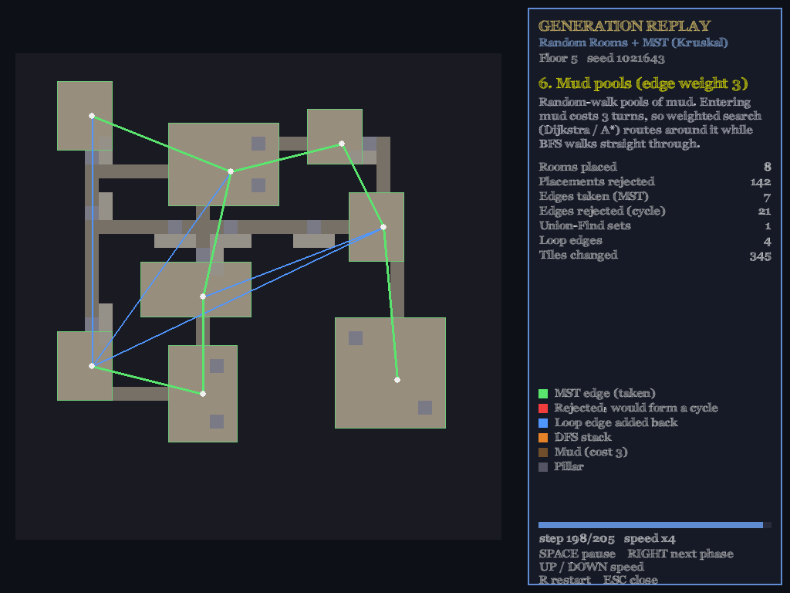
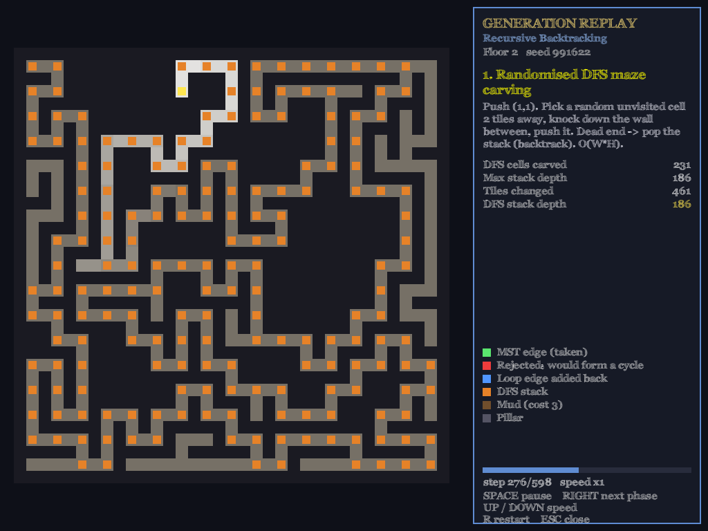
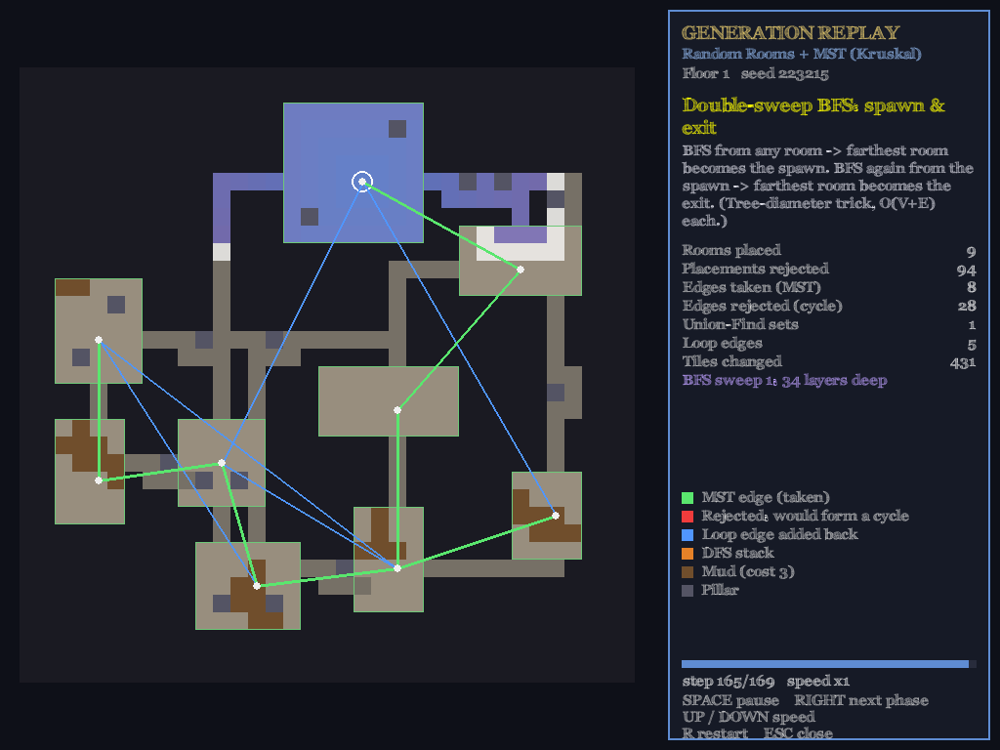
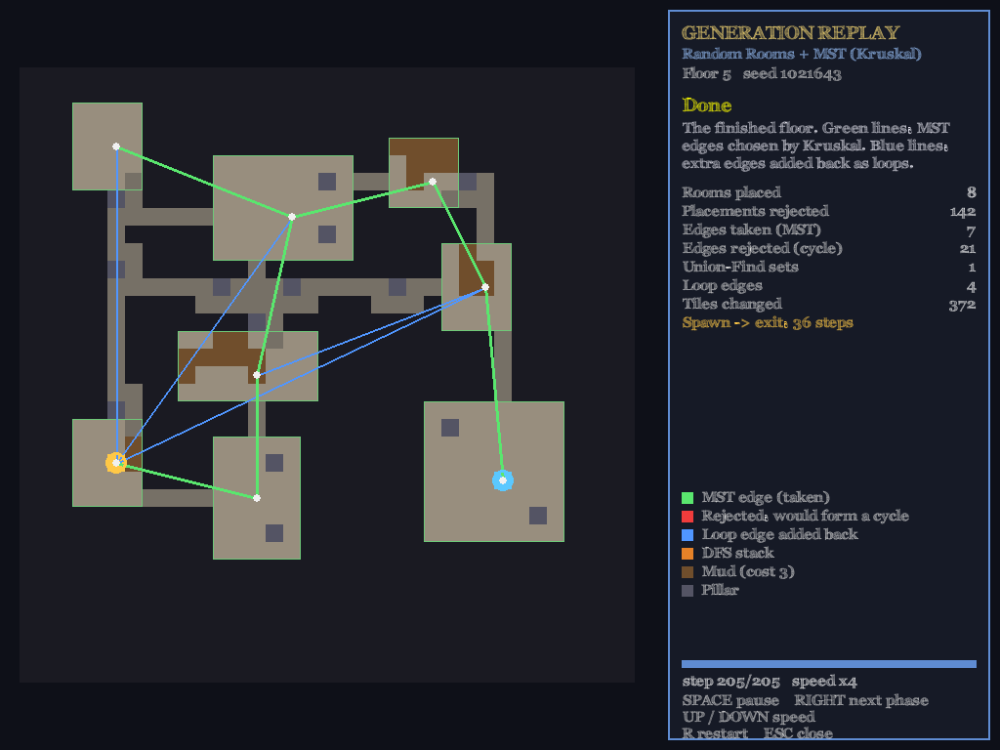

# 2. Procedural Dungeon Generation

## Slide: Two Generators, One Pipeline

```
Rooms + MST (Kruskal)              Recursive Backtracking (DFS maze)
  rejection-sample rooms             carve maze with a stack
  complete graph of room centres     open loops (p = 0.15)
  Kruskal + Union-Find               carve chambers
  add 20% of rejected edges back
  carve L-shaped corridors
                \                     /
                 pillars -> mud pools -> repair -> double-sweep BFS -> stairs -> validate
```

Every floor is reproducible from a seed: floor *n* uses `BASE_SEED + 10007·n`.

## Slide: Kruskal's MST with Union-Find

```
edges = all pairs of room centres, weight = Euclidean distance
sort edges ascending                      # O(E log E), E = K(K-1)/2
for (w, u, v) in edges:
    if find(u) != find(v):                # different components?
        union(u, v); take edge            # no cycle -> part of the MST
    else:
        reject                            # would close a cycle
```

- **Why it is correct**: cut property — the lightest edge crossing any cut is in some MST.
- **Union-Find**: path compression + union by rank → amortised $O(\alpha(n))$, effectively constant.
- **Result**: $K - 1$ corridors that connect every room with minimum total length; then 20 % of rejected edges are added back so there are loops (a pure tree has only one route anywhere).



## Slide: Randomised DFS Maze

- Stack-based DFS over odd-coordinate cells: push a random unvisited neighbour 2 tiles away and knock down the wall; pop when stuck.
- Visits every cell once → $O(W \cdot H)$; produces a **spanning tree** (perfect maze).
- Then: open loops with probability 0.15 and carve 5 chambers.



## Slide: Spawn and Exit — Double-Sweep BFS

1. BFS from any room → farthest room = **spawn**.
2. BFS from spawn → farthest room = **exit**.

- Exact diameter on trees; a fast approximation on graphs with loops.
- Average spawn → exit on 35×35 MST floors: **16 → 31 steps**. Players have to cross the dungeon.



## Slide: Terrain and Validation

- **Mud pools** grown by random walks (8 % of floor tiles) — edge weight 3, costs 3 turns.
- **Pillars** block movement, not sight; corridor pillars get a bypass lane.
- **Validation**: BFS connected components must be 1 and the exit reachable; otherwise corridors are carved between the closest tiles of disconnected parts. 100 % of benchmark floors validate.

## Slide: Watch It Happen — Generation Replay (`B`)

- The generators can record a trace: every room accepted/rejected, every Kruskal decision with weight and Union-Find component count, every DFS push/pop, corridor carving, both BFS sweeps.
- Recording never touches the random number generator → the traced floor is identical (unit-tested).



## Speaker Notes

- **Rejection sampling**: room placement simply retries up to 150 times. The replay shows the rejected attempts flashing red — anywhere from a few dozen to over a hundred rejections for 9 rooms on a 35×35 map, depending on the seed.
- **Kruskal step by step** (use the replay, `→` to jump between phases): edges arrive sorted by length; green = accepted; red = rejected because `find(u) == find(v)`. Point at the "Union-Find sets" counter dropping from 9 to 1 — exactly when it hits 1 the tree is complete, and every later edge is red.
- **Why Kruskal and not Prim**: both give an MST. Kruskal on a complete graph with $K \le 10$ rooms is trivially fast, and the sorted-edge loop is easy to visualise. Prim with a heap would be $O(E \log V)$, the same order here.
- **Double sweep**: on a tree, the farthest node from *any* start is one end of a longest path; a second BFS from it finds the other end. Our floors have loops, so it is a heuristic there — on MST floors the exit lands at 31 steps on average against 34 to the farthest walkable tile.
- **Comparison of the generators** (BENCHMARKS §3): the maze covers 54–60 % of the map with ~16 dead ends at 35×35; MST floors cover 18–29 % with almost no dead ends. Dead ends are used to hide bonus loot.
- If asked about cost: tracing snapshots the grid per corridor, so it is only enabled in game, not in the benchmarks.
