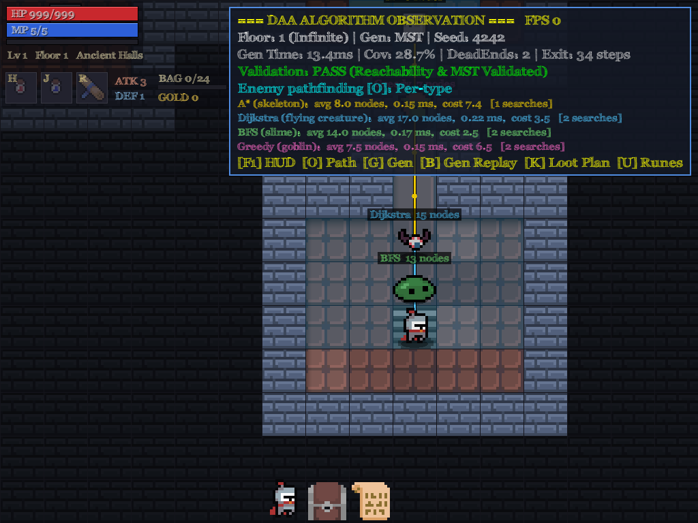

# 3. Pathfinding — One Algorithm per Enemy

## Slide: The Map Is a Weighted Graph

- Vertices: walkable tiles (walls and pillars removed). Edges: 8 directions.
- Weight of stepping onto tile $v$: $t(v) \times (1 \text{ or } \sqrt{2})$ with $t = 3$ for mud, 1 otherwise.
- **Weights are real turns**: entering mud costs 3 turns — for the player (enemies get 2 free moves) and for enemies (stuck for 2 turns). Flying creatures are not slowed.

## Slide: Four Searches, Four Personalities

| Enemy | Algorithm | Priority | Optimal? | Behaviour you see |
| :--- | :--- | :--- | :---: | :--- |
| Slime | **BFS** | queue order | steps only | Walks straight into mud and gets stuck |
| Goblin | **Greedy Best-First** | $h(n)$ | ✗ | Tiny search, often a worse route |
| Skeleton | **A\*** | $g(n) + h(n)$ | ✓ | Goes around mud with a small search |
| Flying beast | **Dijkstra** | $g(n)$ | ✓ | Flies over mud; explores the most |

- `O` forces one algorithm on every enemy to compare them side by side.
- `F1` draws each enemy's planned path in its algorithm's colour and shows live averages.

## Slide: Results on 600 In-Game Chases

| Algorithm | Nodes expanded | Time (ms) | Cost vs optimal | Optimal paths |
| :--- | :---: | :---: | :---: | :---: |
| BFS (slime) | 81.2 | 0.239 | +5.0 % | 77 % |
| Greedy (goblin) | **10.2** | **0.058** | +7.9 % | 60 % |
| A\* (skeleton) | 20.6 | 0.113 | **0 %** | **100 %** |
| Dijkstra (flyer) | 87.9 | 0.368 | **0 %** | **100 %** |

- A\* = Dijkstra's answer with **4.3× fewer** nodes.
- Greedy = the fewest nodes, but wrong 40 % of the time.
- BFS = optimal only when the step-shortest path avoids mud.

## Slide: Why A\* Is Still Optimal

Heuristic in game: Chebyshev $h = \max(|dx|, |dy|)$.

1. Any path needs at least $\max(|dx|, |dy|)$ steps.
2. Every step costs at least 1 (cheapest terrain, orthogonal).
3. So $h(n) \le c^*(n)$ → **admissible** → A\* never returns a worse path than Dijkstra.
4. One step changes $h$ by at most 1 ≤ the step cost → **consistent** → no node is re-opened.

Greedy uses the same $h$ but drops $g(n)$, so nothing stops it from committing to an expensive route.

## Speaker Notes

- **Why one algorithm per enemy**: the textbook trade-offs become behaviour. Students in the audience can predict what each enemy will do from what they know about the algorithm.
- **Live comparison**: press `O` to cycle *Per-type → A\* → Dijkstra → BFS → Greedy*; the F1 panel's "avg nodes" column changes immediately. Forcing BFS makes every enemy walk into mud.
- **Hunting rules**: an enemy notices you within 4 tiles and keeps hunting for 6 turns after losing sight of you, re-planning every turn. If an ally blocks the next tile it side-steps to a free tile that is still closer.
- **Flying beast detail**: in game it runs Dijkstra with terrain ignored (it flies), so the comparison table uses normal weights for it to act as the optimality reference. Say this if asked why its cost equals A\*'s.
- **Honest caveat** (good for viva): the search weights a diagonal step as $\sqrt{2}$ but in the game a diagonal step takes one turn. So the searches minimise distance-weighted cost, not the exact number of turns. They agree on avoiding mud, which is what matters for play.
- **Two implementations**: `src/algorithms/pathfinding_algorithms.py` (raw grid, octile heuristic, unit-tested and benchmarked) and `src/pathfinding.py` (the in-game adjacency-list graph, Chebyshev heuristic). Octile is tighter, so the reference A\* expands fewer nodes; both are admissible.
- **Click-to-move** uses Dijkstra so the player's own auto-routes avoid mud too.
