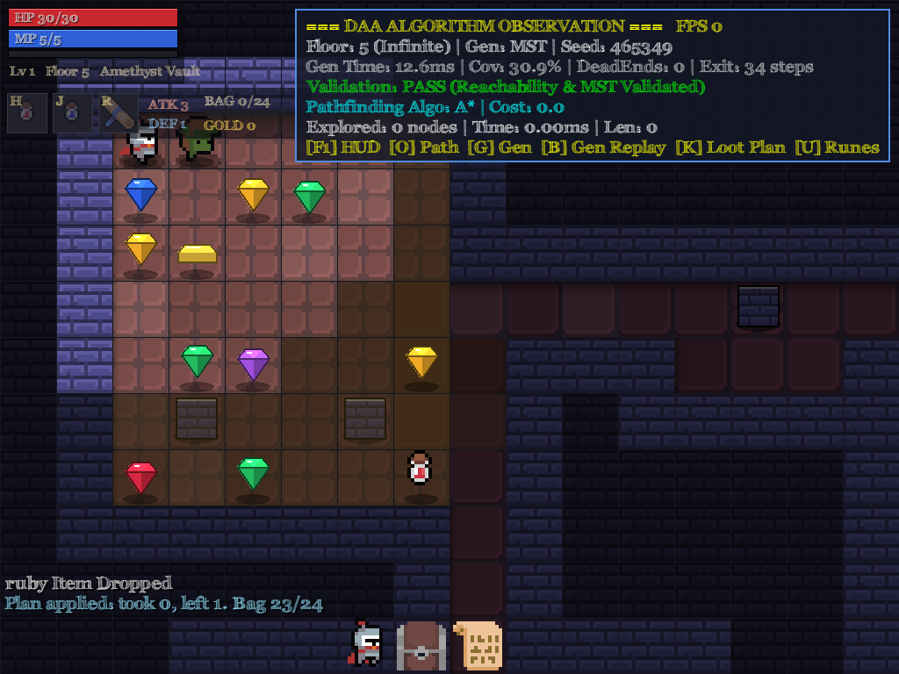
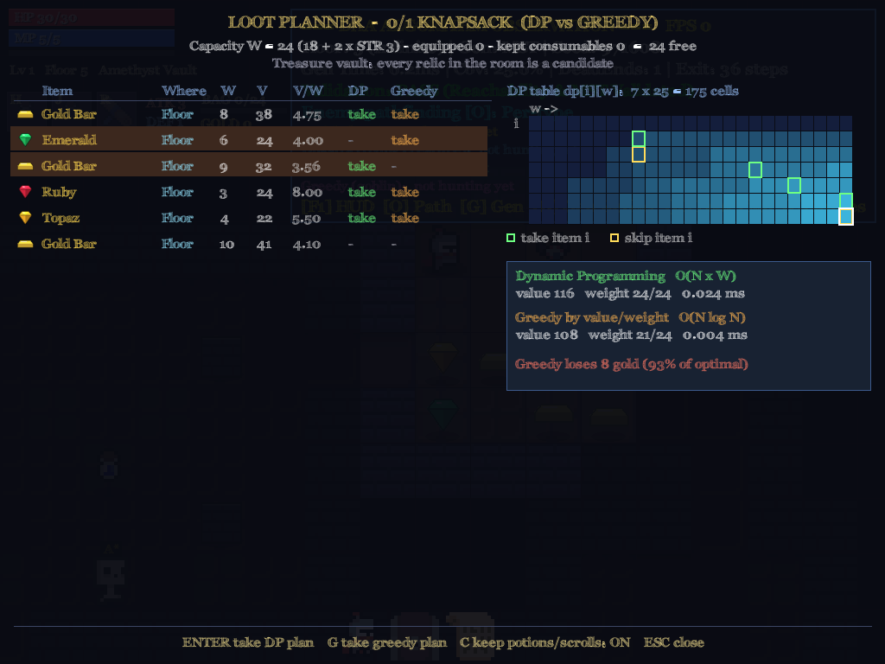

# 4. 0/1 Knapsack — Your Bag Is the Problem

## Slide: The Knapsack Is the Inventory

- Every item has a **weight** and a **gold value**.
- **Capacity** $= 18 + 2 \times \text{STR}$ (24 for a new knight; grows with level).
- Carry more than that → every step costs an extra turn. Walking onto an item that would push you over does not pick it up.
- Each floor has a **treasure vault**: relics (rubies, sapphires, emeralds, topazes, amethysts, gold bars) with random weights and values, totalling **≥ 1.7 × your capacity**. You cannot take everything.
- Relics turn into gold when you go down the stairs.

## Slide: The Planner (`K`)

- Items = your bag + nearby loot (the whole vault when you stand in it).
- $W$ = capacity − equipped gear − potions you choose to keep.
- Runs **DP** and **greedy (value/weight)** side by side, highlights where they disagree, draws the DP table with the reconstruction path, and applies either plan in one key press.

## Slide: The DP

$$DP[i][w] = \max\big(\underbrace{DP[i-1][w]}_{\text{skip item } i},\; \underbrace{DP[i-1][w - w_i] + v_i}_{\text{take item } i \text{ (if it fits)}}\big)$$

- Table of $(N + 1) \times (W + 1)$ cells, filled row by row → $O(N \cdot W)$ time and space.
- **Reconstruction**: from $(N, W)$ walk up; if $DP[i][w] \ne DP[i-1][w]$ item $i$ was taken, so $w \mathrel{-}= w_i$. Those are the green/yellow outlined cells in the heat map.
- **Pseudo-polynomial**: polynomial in the number $W$, not in its bit length — fine for $W \approx 24$.

## Slide: Why Greedy Fails — A Real Vault

Capacity 24. Six relics:

| Relic | w | v | v/w |
| :--- | :-: | :-: | :-: |
| Ruby | 3 | 24 | 8.00 |
| Topaz | 4 | 22 | 5.50 |
| Gold bar | 8 | 38 | 4.75 |
| Gold bar | 10 | 41 | 4.10 |
| Emerald | 6 | 24 | 4.00 |
| Gold bar | 9 | 32 | 3.56 |

- **Greedy** by ratio: Ruby, Topaz, Gold bar (8) → 15; Gold bar (10) doesn't fit; Emerald → 21; Gold bar (9) doesn't fit. **108 gold, 3 capacity wasted.**
- **DP**: Ruby + Topaz + Gold bar (8) + Gold bar (9) = weight **24**, **116 gold**.
- Greedy's early high-ratio picks leave a gap that no remaining item fills exactly.

## Slide: How Often Does It Matter?

| Instances | Greedy sub-optimal | Avg greedy ratio | Worst | DP time |
| :--- | :---: | :---: | :---: | :---: |
| 12 random instances (N = 10–100, loose W) | 3 / 12 | ≥ 99.5 % | 99.5 % | 0.3–25 ms |
| **1,000 realistic vaults** (W = 24) | **550 / 1000** | 96.97 % | **77.0 %** | **0.12 ms** |

Tight capacity + few, chunky items = exactly where greedy breaks — and exactly what the vault is designed to be.

## Speaker Notes

- **Design choice**: the vault is filled to 1.7 × capacity on purpose. Our first version gave 20 total weight against capacity 24 — the player could take everything and the "knapsack" was meaningless. That is a good story to tell: the problem has to be *tight* to be interesting, which is also what the benchmark shows.
- **Fractional vs 0/1**: greedy by ratio is optimal for the fractional knapsack (you could take 3/9 of a gold bar). It's indivisibility that breaks it.
- **Exactness of the example**: the numbers on the slide are from the screenshot; you can verify the greedy and DP totals by hand during the talk.
- **What "apply plan" does**: picks up chosen floor items and drops unchosen bag items; dropped items are flagged so walking over them doesn't pick them up again (you can still take them with `T`).
- **Consumables toggle (`C`)**: by default potions and scrolls are kept and their weight is subtracted from $W$ — the gold value of a potion is low, and an optimiser maximising gold would otherwise throw away your healing.
- **Complexity on the real instance**: $N \le 20$, $W \le 40$ → under 1,000 cells, about 0.1 ms. The DP's cost is irrelevant here; its *exactness* is the point.
