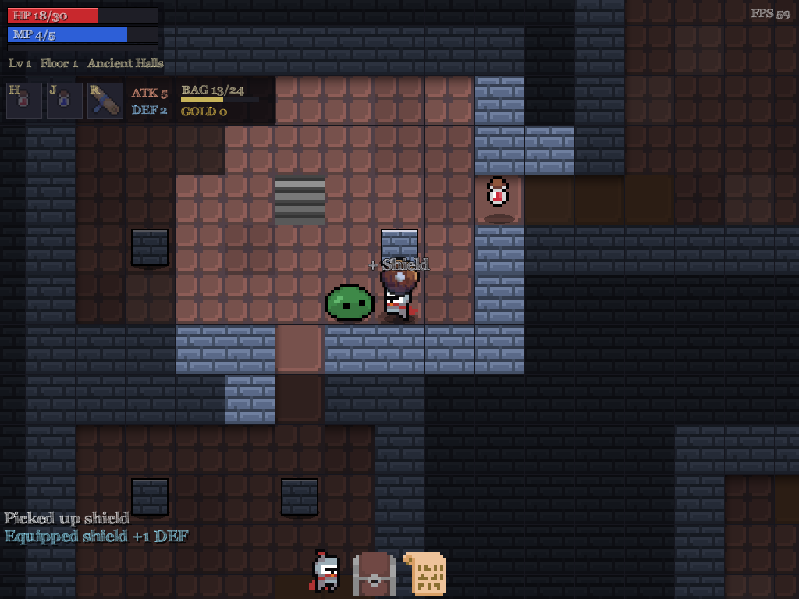

# 6. Engineering — Making It Playable

## Slide: Turn-Based Logic, Smooth Presentation

- Game logic stays on an integer grid, one turn at a time (so the algorithms see a clean graph).
- Everything is animated on top: sprites **glide** between tiles, attacks lunge, damage flashes, numbers float, the camera follows smoothly, spells fly at 60 FPS.
- Slow moves look slow: wading into mud or carrying too much makes the glide longer, and the enemies' extra turns play out one step at a time.
- Hold a key to keep walking; walk onto items to pick them up; `H` / `J` / `R` quick-use potions and scrolls.

## Slide: Placement Rules (BFS Again)

- Enemies and items are placed only on open floor — never inside pillars, on stairs, or stacked.
- Enemies start at least **6 walking steps** (BFS distance) from the player.
- Two corridor dead ends at least 8 steps away may hide bonus loot; the win chest spawns at least half the floor's maximum BFS distance away.

| Audit over 60 floors | Before | After |
| :--- | :---: | :---: |
| Spawned inside pillars | ≈ 4 % | 0 |
| Enemy within 4 steps of the start | ≈ 20 % | 0 |

## Slide: Reproducibility and Testing

- Seeded generation: each run rolls a seed (shown in `F1`); `FIXED_SEED` replays a run exactly; the seed is stored in save files.
- **21 unit tests** — traversal, all four searches (including a test that Greedy Best-First is *not* optimal), heuristic admissibility, generator validity and seed reproducibility, double-sweep exit placement, Kruskal trace properties, knapsack DP / greedy / reconstruction, backtracking.
- **Benchmark suite** — 3,532 records in `benchmark_results.csv`, regenerated with one command.

## Speaker Notes

- This section answers "is it actually a game?" — keep it to a minute.
- The key architectural point: animation is purely visual (`Entity.visual_pos()` interpolates from the last tile to the current one), so none of the algorithms had to change to make movement smooth.
- The placement audit is a nice example of using our own BFS for game design: distances from the spawn decide where enemies may start and where loot is hidden.
