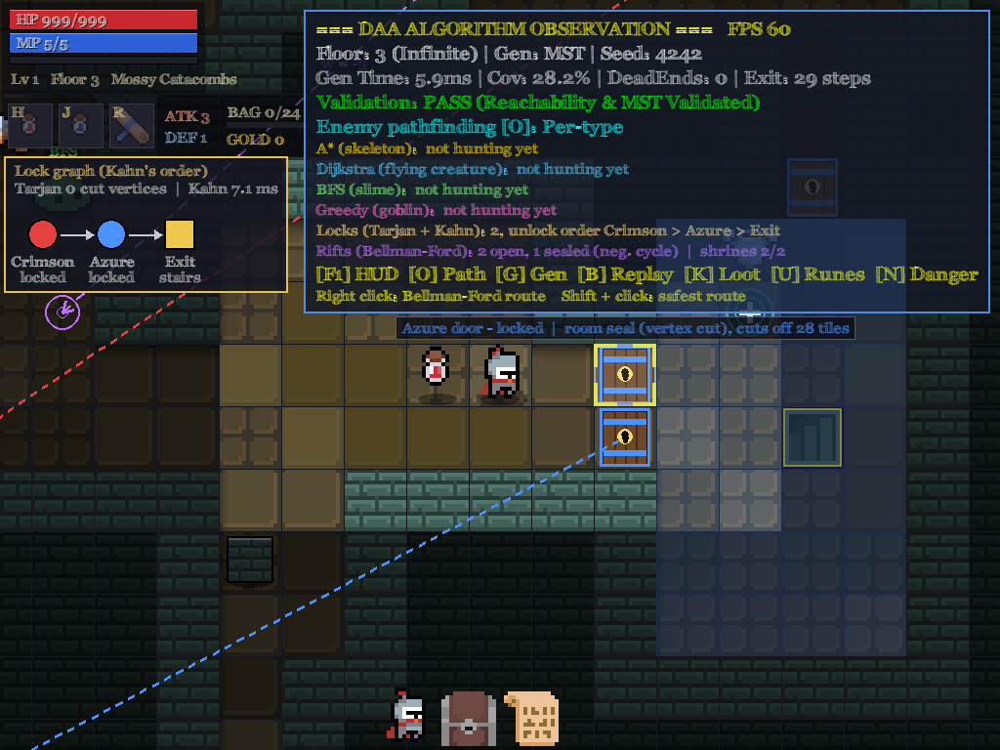

# 6. Locked Doors & Keys — Cut Vertices and Topological Sort

## Slide: The Puzzle

- Every floor has 1–3 locked doors (**Crimson**, **Azure**, **Jade**). Each lock opens with one key lying somewhere on the floor; walk into the door while holding its key.
- On room-and-corridor floors the **exit itself is locked 86 % of the time**, so you have to work out the unlock order to leave.
- The generator must guarantee two things: a key is never behind its own door, and no set of locks deadlocks.



## Slide: Where Can a Door Go? — Tarjan's Articulation Points

- A door only locks something away if it is a **cut**: closing it disconnects part of the floor from the spawn.
- A single-tile cut is an **articulation point**. One DFS from the spawn finds all of them:
  - $tin(v)$ = discovery time, $low(v)$ = smallest $tin$ reachable from $v$'s subtree using one back edge;
  - $u$ is a cut vertex $\iff$ some DFS child $v$ has $low(v) \ge tin(u)$.
- $O(V + E)$. Bonus: the region $u$ cuts off is exactly those children's DFS subtrees — contiguous ranges of the DFS order, so no extra search is needed.
- Iterative, not recursive: maze floors have DFS depth ≈ 700, close to Python's recursion limit.

## Slide: Rooms Need a Vertex *Cut*, Not a Vertex

- Room-and-corridor floors have 2-wide corridors and loops: only ≈ 2.5 cut vertices per floor.
- Generalise: a lock is a **set of door tiles opened by one key**. The walkable ring around a room is always a vertex cut, so it becomes a **room seal**. A BFS with the lock's tiles closed gives the region behind it.

| Floor type (50 floors each) | Cut vertices | Locks placed (max 3) | Exit locked | Solvable |
| :--- | :---: | :---: | :---: | :---: |
| Rooms + MST | 2.5 | **2.90** | **86 %** | 100 % |
| Recursive Backtracking | 27.2 | 1.36 | 0 % | 100 % |

## Slide: The Dependency Graph and Kahn's Algorithm

- Edge $d \to i$: with lock $d$ closed, lock $i$'s key or every one of $i$'s doors is out of reach.
- Edge $d \to \text{Exit}$: closing $d$ alone cuts off the stairs.

```
queue = all nodes with in-degree 0
while queue:
    n = queue.pop();  order.append(n)
    for m in out[n]:
        indeg[m] -= 1
        if indeg[m] == 0: queue.append(m)
leftover nodes  =>  a cycle  =>  deadlock
```

- The order is shown live in the F1 lock-graph panel (left side): *Crimson → Azure → Exit*.

## Slide: Guaranteed Solvable

1. **By construction**: each key goes on a tile reachable with only the earlier locks open (preferably inside the previous lock's region, which chains them). Every dependency edge then points forward → the graph is a DAG.
2. **Independent check**: Kahn recomputes the order from the finished floor, and that order is replayed step by step (keys and doors must be reachable at each step).
3. **Ground truth in the tests**: a flood-fill simulation that knows nothing about the graph — collect reachable keys, open reachable doors, repeat — must reach the exit.

100 / 100 benchmark floors solvable; 0 locks ever dropped by the check. Cost: Tarjan ≈ 7 ms (rooms) / 15 ms (maze), whole plan ≈ 74 ms, once per floor.

## Speaker Notes

- **Demo hook**: hover a locked door (or its key). The tinted region is literally Tarjan's subtree for a doorway lock, or the BFS region for a room seal. The F1 dashed line joins each key to its door.
- **Why edges are only necessary conditions**: they are computed with *one* lock closed. With several locks closed, a room can be reachable through either of two doors (an OR), which a plain dependency edge can't express. That is why Kahn's order is replayed and not just trusted; if the replay failed, the last lock would be dropped. It never failed in the benchmark.
- **Maze floors** (honest caveat): maze chambers have more than 4 entrances, so they are never sealed; their doors guard side branches and the exit is never locked there.
- **Rifts can't skip doors**: a rift's entrance and exit must be at the same unlock stage (the number of locks you need open to reach a tile, from the replay). The teleport scroll only targets tiles you can reach right now.
- **Complexity**: Tarjan $O(V+E)$; one BFS per candidate room seal; dependency edges need one BFS per pair of locks, $O(L^2 (V+E))$ with $L \le 3$; Kahn $O(L + D)$.
- Code: [`src/algorithms/locks.py`](../src/algorithms/locks.py) (pure, tested), [`src/dungeon_features.py`](../src/dungeon_features.py) (in game).
