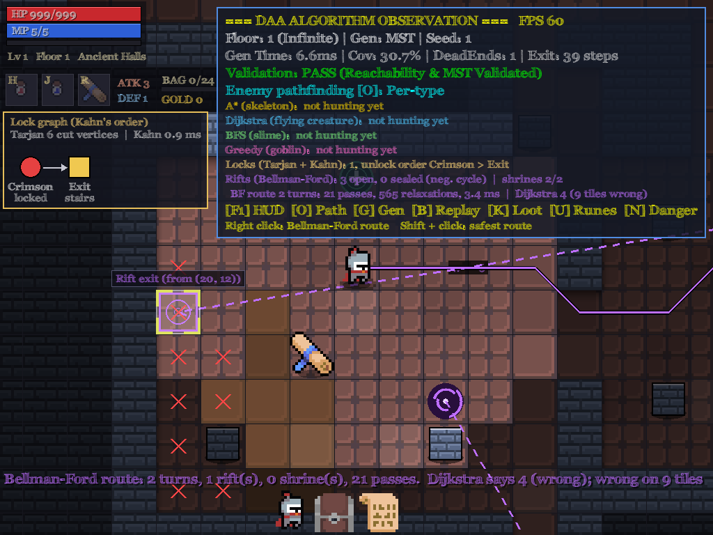

# 7. Negative Edge Weights — Shrines, Time Rifts and Bellman–Ford

## Slide: Turns Are Edge Weights — and Some Are Negative

The game already prices moves in turns: entering a tile costs 1, mud costs 3. Two new features give turns *back* (enemies skip their turns while you have free turns):

| Feature | Effect | Edge weight |
| :--- | :--- | :---: |
| Healing shrine (single use) | heals ⅓ HP + **2 free turns** | $1 - 2 = -1$ |
| Time rift A → B (one-way) | teleports to B, rewinds **R = 3–7** turns | $1 - R$ |

**Right-click** anywhere: the fewest-turns route, using shrines and rifts. It walks there automatically.

## Slide: Why Dijkstra Breaks

- Dijkstra *settles* a node once, assuming nothing found later can be cheaper. That is only true when every weight is ≥ 0.
- Smallest counterexample (it's a unit test): $s \to a$ 1, $a \to t$ 1, $s \to b$ 3, $b \to a$ −3. Dijkstra settles $a$ at 1 (true 0) and $t$ at 2 (true 1).
- In the game, on the same graph, from the spawn:

| Floors (50 each) | Textbook Dijkstra wrong | Tiles wrong (when it is wrong) | Worst error |
| :--- | :---: | :---: | :---: |
| Rooms + MST | 18 % of floors | 15.6 | 3 turns |
| Recursive Backtracking | 48 % of floors | 55.5 | 6 turns |

With F1 on, a right-click route marks every tile where Dijkstra's answer would be wrong with a red ✗.



## Slide: Bellman–Ford

```
dist[s] = 0
repeat up to V - 1 times:
    changed = False
    for (u, v, w) in edges:
        if dist[u] + w < dist[v]:
            dist[v] = dist[u] + w;  parent[v] = u;  changed = True
    if not changed: stop                    # early exit
    if parent pointers contain a cycle:     # = negative cycle (CLRS Lemma 24.16)
        report it
```

- $O(V \cdot E)$ worst case. Early exit makes it practical: **13.6 passes** instead of $V - 1 \approx 342$ on room floors (8.7 ms); 26.7 passes on mazes (34 ms).
- Dijkstra takes 0.6 / 2.0 ms on the same graphs. That gap is the price of correctness with negative weights.

## Slide: Negative Cycles = Infinite Free Turns

- A rift whose exit is $k$ steps from its entrance: walk back ($k$ turns), jump again ($1 - R$). The cycle weight is $k + 1 - R$, negative when $k < R - 1$: farm free turns forever, and "shortest path" is undefined.
- **The generator runs Bellman–Ford from a virtual source** (every node starts at distance 0, so a negative cycle anywhere is found). It reads the cycle off the parent pointers, seals the rift on it, and repeats until there are none.
- **36 of 300 rifts sealed (12 %)**: 25 / 150 on room floors, 11 / 150 on mazes. A sealed rift appears on 46 % of room floors and 20 % of maze floors (drawn cracked, with a message).
- Shrines alone can never form a negative cycle: they are placed ≥ 3 tiles apart, so every −1 step is followed by a +1 step (cycle weight ≥ 0).

## Speaker Notes

- **Predecessor-cycle check**: CLRS Lemma 24.16 says that with no negative cycle reachable from the source, the predecessor subgraph is always a tree. A cycle in it therefore *proves* a negative cycle, usually many passes before pass V.
- **Why the weights match the game exactly**: free turns really are spent paying for the player's moves (mud included). Entering a shrine costs 1 turn, during which the enemies act, and banks 2. You can see the blue "Time frozen" tag above the player and the enemies tinted blue.
- **Single-use shrines** make the true problem state-dependent (the graph changes after you use one). The planner re-plans on every right-click with the current graph, so it is exact for the state you are in.
- **Turn model**: the planner counts a diagonal step as 1 turn (exact). The enemies' searches (section 3) still use $\sqrt{2}$.
- **Why not Johnson's algorithm?** Johnson's runs Bellman–Ford once to reweight, then Dijkstra from *every* node — it is for all-pairs. We need one source per click.
- Code: [`src/algorithms/negative_weights.py`](../src/algorithms/negative_weights.py).
