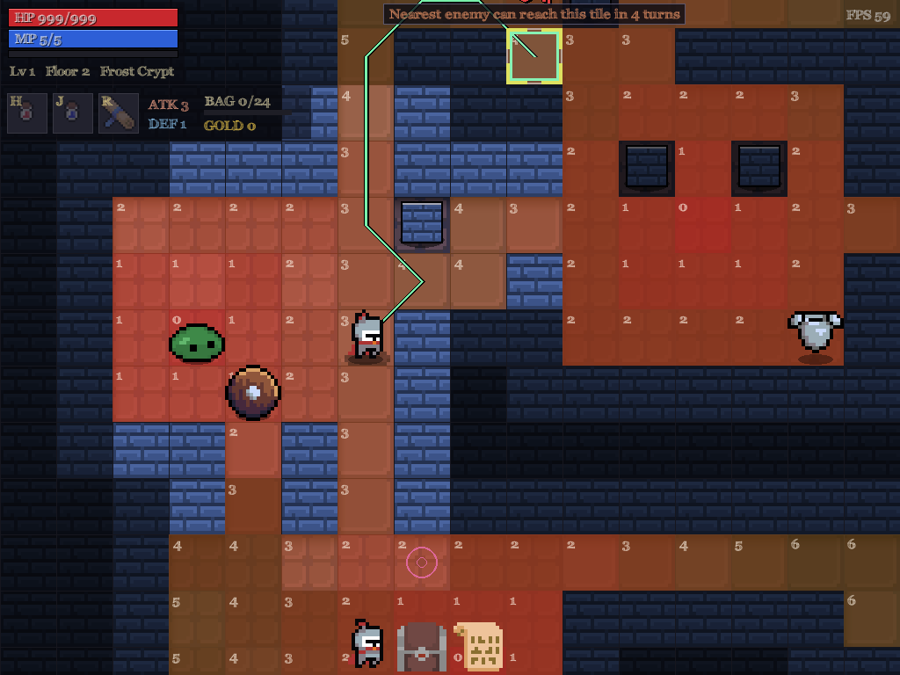

# 8. Danger Map — Multi-Source Shortest Paths

## Slide: How Close Is the Nearest Enemy?

- Press **`N`**: every tile shows how many turns until the nearest enemy could stand there (red = close).
- Walking enemies: **multi-source Dijkstra** (mud costs 3 turns). Flying enemies: **multi-source BFS** (every step costs 1). Danger = the minimum of the two.
- Locked doors block enemies too, so tiles behind a closed door are safe.

## Slide: One Search Instead of k

- Put every enemy in the priority queue at distance 0. That is Dijkstra from a virtual **super-source** joined to each enemy by a 0-weight edge.
- Same answer as running one search per enemy and taking the minimum (unit-tested on every tile). The cost no longer depends on the number of enemies.

| Enemies | One multi-source search | k separate searches | Speed-up |
| :---: | :---: | :---: | :---: |
| 4 | 349 nodes, 3.85 ms | 1,396 nodes, 14.85 ms | **3.9×** |
| 8 | 349 nodes, 3.43 ms | 2,792 nodes, 29.05 ms | **8.5×** |
| 16 | 349 nodes, 3.75 ms | 5,583 nodes, 58.98 ms | **15.7×** |

(30 room floors per row; answers identical in 100 % of cases.)

## Slide: Safest Route (Shift + Click)

- Dijkstra with $cost(v) = turns(v) + 3 \cdot \max(0,\ 4 - danger(v))$.
- Every weight is still ≥ 0, so plain Dijkstra is exact. That's the contrast with section 7.
- **Guarantee**: the safe route never collects more danger penalty than the shortest route. It minimises turns + penalty while the shortest route minimises turns alone, so $turns_{safe} \ge turns_{short}$ forces $penalty_{safe} \le penalty_{short}$.
- In the screenshot: 8 turns instead of 6, in exchange for staying further from the enemies.

## Speaker Notes

- The map is recomputed only when an enemy moves (cached between frames), about 2–4 ms on a 35×35 floor.
- **Why turns, not tiles**: with mud, "3 tiles away" can mean 3 turns or 9. Measuring turns is what makes this a weighted problem.
- **Super-source argument**: add a node $s^*$ with 0-weight edges to every enemy. The shortest path from $s^*$ to $v$ is $\min_i dist(enemy_i, v)$, and seeding the queue with all enemies at 0 is exactly the first step of Dijkstra from $s^*$.
- **Where it could go next**: the same map, computed from the *player* instead, gives every enemy its next step by following the gradient. That replaces one search per enemy with one search per turn (see the viva questions).
- Code: [`src/algorithms/danger_map.py`](../src/algorithms/danger_map.py).
